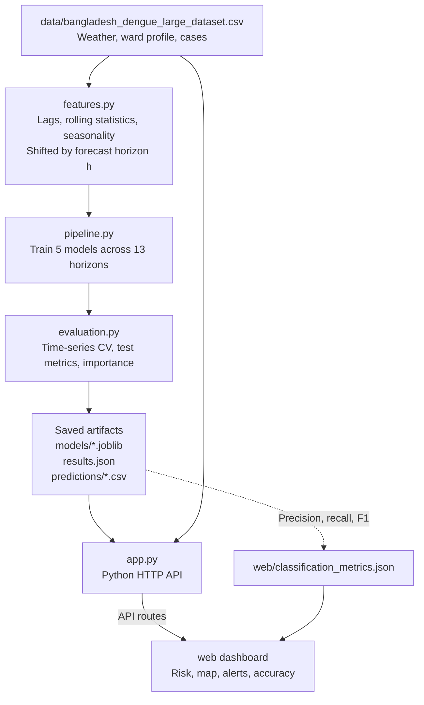
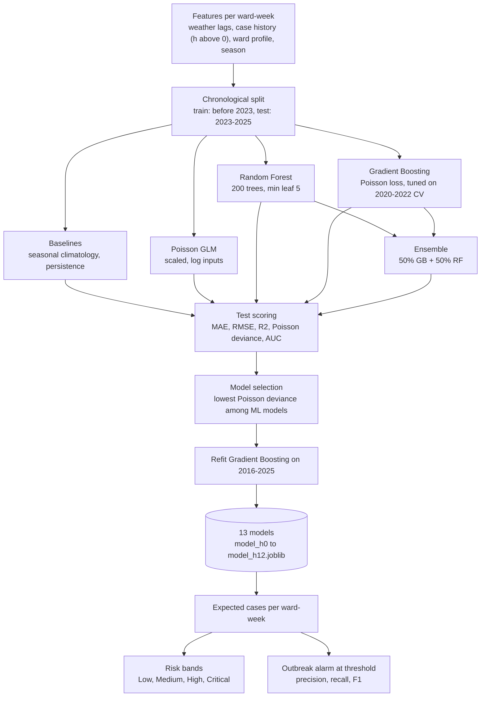
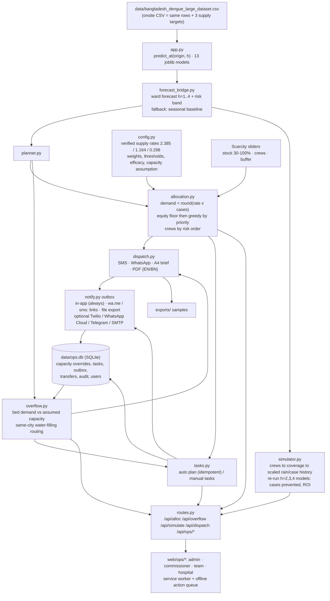
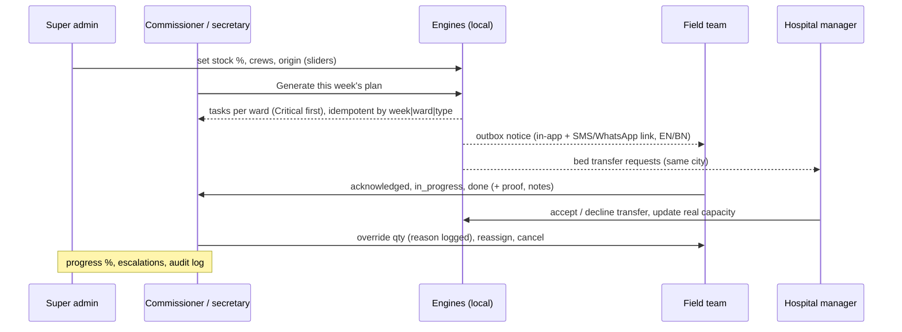
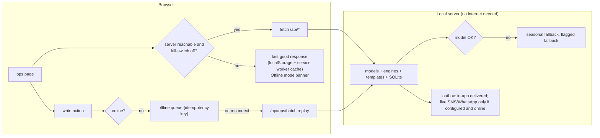

# Dengue Watch: Architecture Design

Ward-level dengue forecasting for 60 wards in 5 Bangladesh cities (Chattogram, Dhaka North, Dhaka South, Gazipur, Narayanganj), weekly data 2016-2025. The system predicts expected cases per ward-week 0 to 12 weeks ahead and turns them into Low / Medium / High / Critical risk bands.

## 1. System data flow

### Model flow

**Offline (training):** `python scripts/train_dengue.py` reads the CSV, builds features for each horizon, trains and scores five models, and writes everything to `artifacts/`.

**Online (serving):** `python app.py` loads the 13 saved models (`model_h0` to `model_h12`) and the CSV. For each request it rebuilds features from the last 30 weeks of history, predicts, and returns JSON to the browser. No training happens at request time and no external API is called.

**Inputs per ward-week (37 to 45 features):** rainfall, temperature and humidity lags and rolling sums/means; ward case history (forecast horizons 1-12 only; horizon 0 is a weather-only nowcast); density, sanitation, water-logging and city flags; sine/cosine of week of year. All time-varying inputs are shifted back by the horizon, so the model only uses information available at forecast time (no leakage).

## 2. Chronological validation split

Random splits would leak future weeks into training, so every split respects time order.

| Purpose | Training data | Evaluation data |
|---|---|---|
| Final test | years before 2023 (about 21,000 rows) | 2023-2025 (9,420 rows) |
| Hyperparameter tuning | expanding window: before 2020 | 2020 |
| | before 2021 | 2021 |
| | before 2022 | 2022 |

- Tuning: 10 random Gradient Boosting configurations are compared by mean Poisson deviance over the three expanding-window folds. The test years are never used for tuning.
- Test: all five models are trained on pre-2023 data only and scored once on 2023-2025.
- Deployment: the chosen model is then refit on all years (2016-2025) and saved. Test metrics come from the earlier train-only fit, so they are the honest accuracy figures. Back-testing a 2023-2025 date in the app uses a model that has seen that date and will look better than it is.

## 3. Model selection rationale

Five candidates are trained per horizon: seasonal climatology and persistence (baselines), Poisson GLM, Random Forest, tuned Gradient Boosting, and a 50/50 GB + RF ensemble.

- **Poisson loss.** The target is a count per ward-week and 58% of rows are zero. Poisson deviance fits this better than squared error, and it is the selection metric (lowest deviance among the ML models).
- **Baselines.** They show whether the weather and case features add value. Persistence collapses as the horizon grows (R2 below zero at 12 weeks), which is why a model is needed.
- **Gradient Boosting.** It captures non-linear lagged weather effects (rain a few weeks earlier, humidity, season) and interactions with ward traits. At the weather-only nowcast it clearly wins (MAE 0.87, deviance 0.68, R2 0.85, outbreak AUC 0.98).
- **Honest result.** Across the 13 horizons the best model by test deviance was Gradient Boosting at 6, the ensemble at 5, and the Poisson GLM at 2. Differences between the three are small at long horizons, where all models approach the seasonal baseline (3 weeks: MAE 1.10 vs 1.36; 12 weeks: 1.36 vs 1.36).
- **Why Gradient Boosting is deployed.** It is the best or near-best everywhere, supports Poisson loss natively, and gives the permutation importance and partial-dependence outputs the dashboard shows. One model type for all horizons keeps serving and the API simple. A possible improvement is to deploy the per-horizon winner.
- **Outbreak warnings.** An outbreak is 10+ cases in a ward-week; an alarm is a prediction at or above the chosen threshold. At threshold 10, 3 weeks ahead: precision 67.9%, recall 55.7%, F1 61.2%.

Limitation: research decision-support prototype, not an official forecast.

---

# Phase 2 (onsite final): operations command system

Phase 2 turns the Phase 1 forecasts into an operational system for ward commissioners, their
secretaries, field teams, hospital managers and a regional super admin. Everything new lives in
`src/dengue_watch/ops/` and `web/ops/`; `app.py` only gained one route hook per HTTP verb, so every
Phase 1 endpoint and page works exactly as before.

| Module | Requirement | What it does |
|---|---|---|
| `ops/config.py` | all | Every rate, weight, threshold and assumption in one documented file |
| `ops/forecast_bridge.py` | 1-5 | Reuses `app.predict_at` + the 13 models; batched counterfactual prediction; deterministic seasonal fallback |
| `ops/allocation.py` | 1 | Constrained allocation of saline / kits / beds + spraying crews under the 30-100% stock slider |
| `ops/overflow.py` | 2 | Intra-city bed overflow routing (water-filling to the lowest-burden ward) and city-surge alerts |
| `ops/simulator.py` | 3 | Model-driven what-if vector control: perturb features, re-run h=2,3,4 models, ROI ranking |
| `ops/dispatch.py` | 4 | Deterministic EN/BN templates: SMS, WhatsApp, printable A4 HTML brief, PDF (optional reportlab) |
| `ops/planner.py` | 1-2 | One call: forecast -> allocation -> overflow for a planning week |
| `ops/db.py`, `ops/auth.py` | platform | SQLite state (stdlib), PBKDF2 passwords, HMAC sessions, CSRF, login rate limit |
| `ops/tasks.py`, `ops/notify.py` | 4 | Task lifecycle, idempotent auto plan, outbox + channel adapters |
| `ops/routes.py` | all | HTTP endpoints, offline self-check |

## 4. Phase 2 data flow

### 4.1 Supply rule (verified, not assumed)
`scripts/verify_onsite_dataset.py` proves the onsite file has the same 31,320 rows as Phase 1 and that
each new target is an exact function of `dengue_cases`: `target = round_half_up(rate x cases)` with
saline 2.385, kits 1.164, beds 0.298 (feasible intervals [2.3834, 2.3863], [1.1618, 1.1666],
[0.2969, 0.3000)); 100% of rows match. The same rule converts forecast cases into demand.

### 4.2 Allocation (Requirement 1)
`priority = risk_weight x (cases + 0.5) x sqrt(density / median density)` with weights
Critical 4, High 3, Medium 2, Low 1. Stock at 100% = demand of the peak week in the 4-week window
(admin can override absolute numbers). Per supply: an equity floor (Critical 60%, High 40% of their
own demand) is granted first, then wards are topped up greedily in priority order (ties by ward_id).
Because every unit costs one unit of stock, maximising priority-weighted delivered units is a
fractional knapsack with equal weights, which greedy-by-priority solves optimally. Fulfilment
below 100% = WARNING, below 60% = CRITICAL. Crews needed = ceil(base[risk] x density factor) (0-4),
assigned Critical, then High, Medium, Low.

### 4.3 Overflow (Requirement 2) and the capacity ASSUMPTION
The dataset has **no bed-capacity column**. Assumed baseline (editable in the Hospital portal,
stored in SQLite, labelled "assumed" everywhere): a city's bed pool is the sum of its wards'
P85 weekly bed requirement, split across the city's wards by population density (a population
proxy). Demand also depends on water-logging, sanitation and rain, so some wards exceed capacity
while neighbours have headroom. Routing moves one patient at a time to the same-city ward with the
lowest utilisation after receiving (water-filling). Patients are conserved; cross-city transfers
are impossible by construction and tested. If a whole city lacks beds, a CITY SURGE alert is raised.

### 4.4 Simulator (Requirement 3)
`coverage = 1 - exp(-0.6 x crews / density_factor)`; larviciding multiplies the ward's last 4 weeks
of rainfall (breeding habitat) by `1 - 0.6 x coverage`, fogging multiplies its last 4 weeks of case
history (transmission pressure) by `1 - 0.4 x coverage`. The perturbed ward copies (60 wards x 0-4
crews) are pushed through the h=2,3,4 Gradient Boosting models in one batched call per horizon.
Cases prevented = baseline - counterfactual, guarded to be non-negative and non-decreasing in crews.
ROI = cases prevented over weeks 2-4 / crews; a greedy marginal-ROI loop recommends the deployment.

## 5. Roles and task flow

| Role | Scope | Can |
|---|---|---|
| super_admin | all 60 wards | sliders, settings, kill-switches, generate all, exports, audit |
| commissioner | own ward | generate plan, create / edit / override / reassign / cancel tasks, send notices, briefs |
| secretary | own ward | same as commissioner (dispatches on their behalf); cannot change passwords or roles |
| saline_team / spraying_team / bed_team | own city, own task type | acknowledge, start, done, blocked, notes, proof |
| hospital | own city | bed view, accept / decline transfers, edit capacity / occupancy |

Security: PBKDF2-HMAC-SHA256 (120k iterations, per-user salt), HMAC-signed session cookie
(HttpOnly, SameSite=Lax, Secure behind HTTPS) with server-side revocation, CSRF token on every POST,
login rate limit, role + ward/city scoping on every query (tested: a commissioner cannot read or
change another ward's tasks).

## 6. Offline design

- No network call exists in forecasting, allocation, routing, simulation or templates (`/api/ops/health`
  runs a static self-check; `tests/test_offline.py` blocks every socket and runs the full pipeline).
- All web assets are local (fonts self-hosted in `web/assets/fonts/`); `sw.js` caches the app shell
  and the last API responses; `manifest.webmanifest` makes it installable.
- Kill-switches for the live demo: browser "Offline kill-switch demo" (sidebar), admin "Model
  kill-switch" (forces the fallback forecast) and "Server internet kill-switch" (notification adapters).
- Full math defense: [docs/OFFLINE.md](docs/OFFLINE.md). Q&A prep: [docs/QA_CHEATSHEET.md](docs/QA_CHEATSHEET.md).

## 7. Assumptions (all configurable in `ops/config.py`)

| Assumption | Default | Why |
|---|---|---|
| Planning origin | 2025-08-04 (peak 2025) | last data week (2025-12-29) is off-season, about 1 case region-wide |
| 100% regional stock | peak-week demand of next 4 weeks | slider then expresses real scarcity relative to need |
| Bed capacity | city pool = sum of ward P85, split by density | dataset has no capacity column; editable |
| Equity floor | Critical 60%, High 40% | fairness guard before greedy fill |
| Crew need | Critical 3, High 2, Medium 1, Low 0, x sqrt density factor, max 4 | denser wards need more teams |
| Simulator efficacy | larvicide 0.6, fogging 0.4, coverage k = 0.6 | mid-range field values; planning parameters |
| Escalation | 12 h unacknowledged; due 1-3 days by task type | editable in Settings |

## 8. AI disclosure

AI assistants were used during development. Claude (Anthropic), via Claude Code, generated most of
the Phase 2 code (the `ops/` engines, SQLite / auth layer, API routes, the `web/ops/` pages, the
service worker, the tests, the export script) and drafts of this documentation, working from a
team-written specification; it also ran the verification scripts and browser checks. The team
reviewed the generated code and outputs, chose the assumptions (capacity, stock baseline, crew
sizing, efficacy), checked the math against the dataset (supply-rule verification and engine tests)
and is responsible for the submission. No LLM or external AI API is called at runtime: every
forecast, allocation, route, simulation and dispatch notice is produced locally and deterministically.
