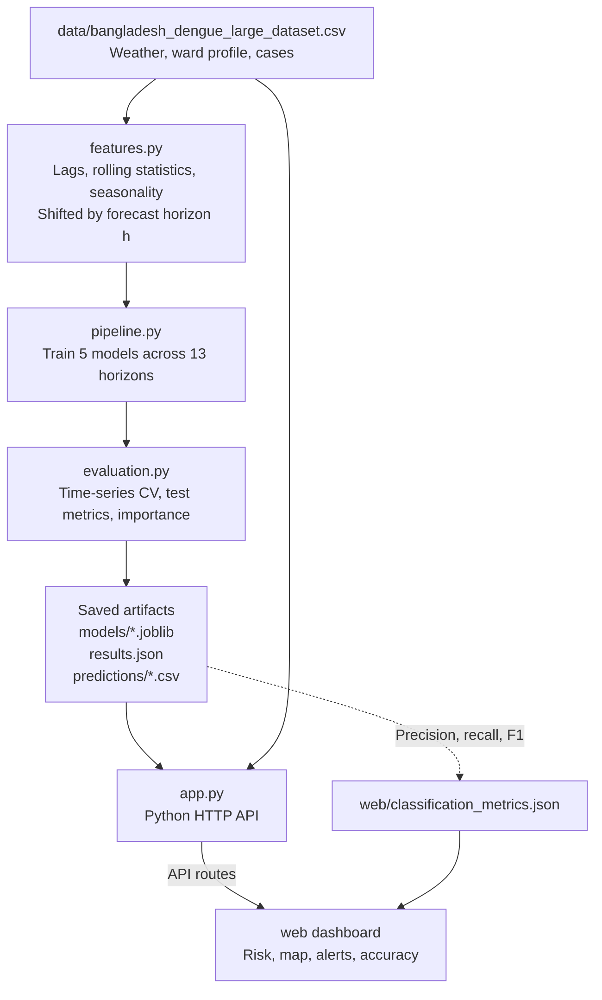
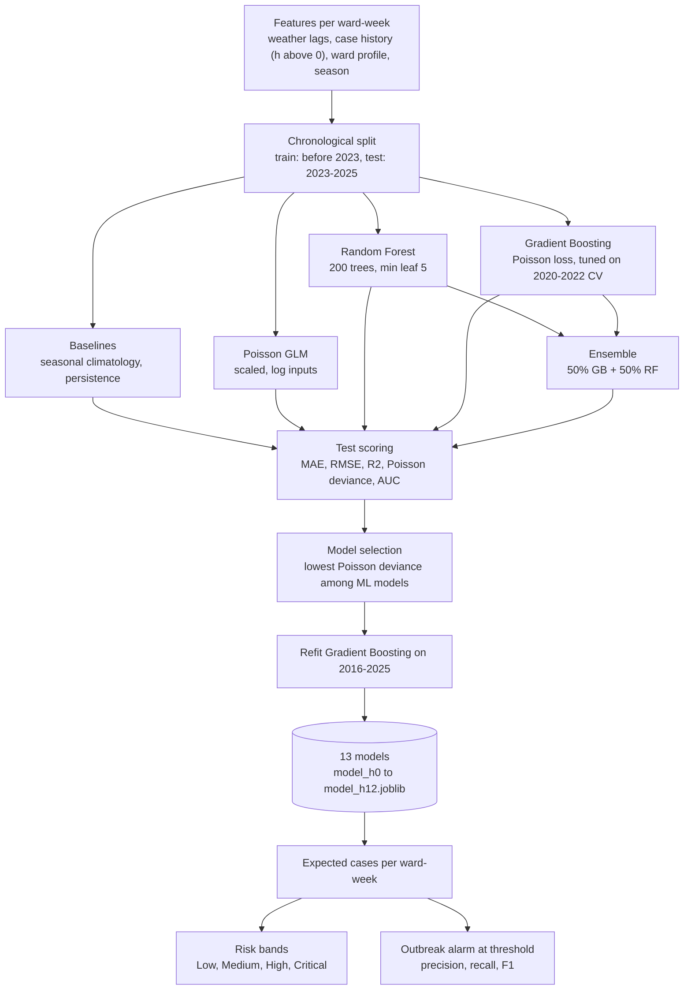

# Dengue Watch: Architecture Design

Ward-level dengue forecasting for 60 wards in 5 Bangladesh cities (Chattogram, Dhaka North, Dhaka South, Gazipur, Narayanganj), weekly data 2016-2025. The system predicts expected cases per ward-week 0 to 12 weeks ahead and turns them into Low / Medium / High / Critical risk bands.

## 1. System data flow


```

### Model flow



**Offline (training):** `python scripts/train_dengue.py` reads the CSV, builds features for each horizon, trains and scores five models, and writes everything to `artifacts/`.

**Online (serving):** `python app.py` loads the 13 saved models (`model_h0` to `model_h12`) and the CSV. For each request it rebuilds features from the last 30 weeks of history, predicts, and returns JSON to the browser. No training happens at request time and no external API is called.

**Inputs per ward-week (37 to 45 features):** rainfall, temperature and humidity lags and rolling sums/means; ward case history (forecast horizons 1-12 only; horizon 0 is a weather-only nowcast); density, sanitation, water-logging and city flags; sine/cosine of week of year. All time-varying inputs are shifted back by the horizon, so the model only uses information available at forecast time (no leakage).

## 2. Chronological validation split

Random splits would leak future weeks into training, so every split respects time order.

| Purpose | Training data | Evaluation data |
|---|---|---|
| Final test | years before 2023 (about 21,000 rows) | 2023-2025 (9,420 rows) |
| Hyperparameter tuning | expanding window: before 2020 | 2020 |
| | before 2021 | 2021 |
| | before 2022 | 2022 |

- Tuning: 10 random Gradient Boosting configurations are compared by mean Poisson deviance over the three expanding-window folds. The test years are never used for tuning.
- Test: all five models are trained on pre-2023 data only and scored once on 2023-2025.
- Deployment: the chosen model is then refit on all years (2016-2025) and saved. Test metrics come from the earlier train-only fit, so they are the honest accuracy figures. Back-testing a 2023-2025 date in the app uses a model that has seen that date and will look better than it is.

## 3. Model selection rationale

Five candidates are trained per horizon: seasonal climatology and persistence (baselines), Poisson GLM, Random Forest, tuned Gradient Boosting, and a 50/50 GB + RF ensemble.

- **Poisson loss.** The target is a count per ward-week and 58% of rows are zero. Poisson deviance fits this better than squared error, and it is the selection metric (lowest deviance among the ML models).
- **Baselines.** They show whether the weather and case features add value. Persistence collapses as the horizon grows (R2 below zero at 12 weeks), which is why a model is needed.
- **Gradient Boosting.** It captures non-linear lagged weather effects (rain a few weeks earlier, humidity, season) and interactions with ward traits. At the weather-only nowcast it clearly wins (MAE 0.87, deviance 0.68, R2 0.85, outbreak AUC 0.98).
- **Honest result.** Across the 13 horizons the best model by test deviance was Gradient Boosting at 6, the ensemble at 5, and the Poisson GLM at 2. Differences between the three are small at long horizons, where all models approach the seasonal baseline (3 weeks: MAE 1.10 vs 1.36; 12 weeks: 1.36 vs 1.36).
- **Why Gradient Boosting is deployed.** It is the best or near-best everywhere, supports Poisson loss natively, and gives the permutation importance and partial-dependence outputs the dashboard shows. One model type for all horizons keeps serving and the API simple. A possible improvement is to deploy the per-horizon winner.
- **Outbreak warnings.** An outbreak is 10+ cases in a ward-week; an alarm is a prediction at or above the chosen threshold. At threshold 10, 3 weeks ahead: precision 67.9%, recall 55.7%, F1 61.2%.

Limitation: research decision-support prototype, not an official forecast.
