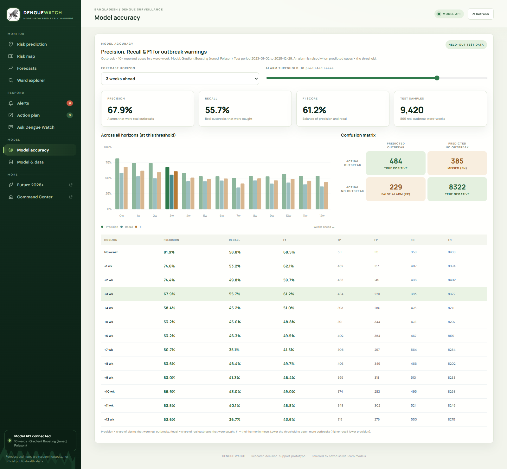
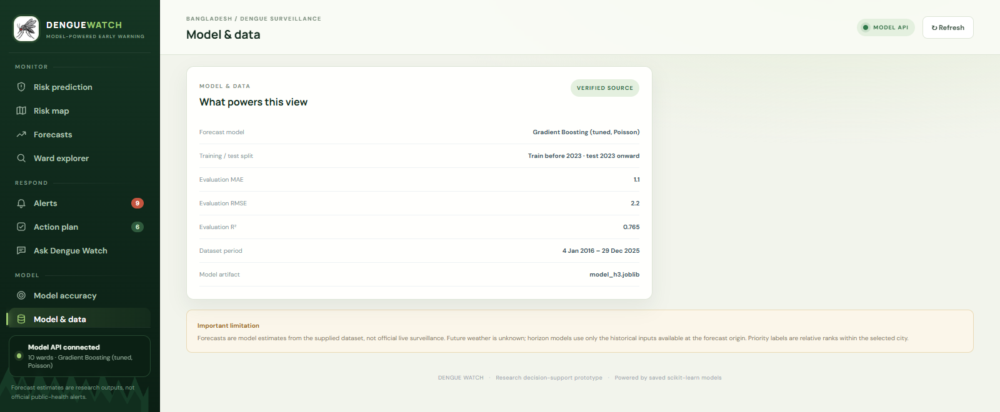

# Dengue Watch

Ward-level dengue forecasting and early-warning dashboard for Bangladesh.

[Live demo](https://dengue-watcher.onrender.com) · [Architecture notes](ARCHITECTURE.md) · [Project plan](plan.md)

Dengue Watch forecasts weekly dengue cases for 60 wards in five cities (Dhaka North, Dhaka South, Chattogram, Gazipur, Narayanganj). It looks 0 to 12 weeks ahead with trained models and gives a seasonal outlook for 2026 and beyond. Forecasts become Low, Medium, High and Critical risk bands, ranked wards, alerts, an action plan and a bilingual (English and Bangla) assistant.

This is a research prototype built on the supplied dataset. It is not an official public-health alert.

## 1. Project Objective

Dengue peaks every monsoon, and city teams need to decide where to send inspection and clean-up crews before cases are reported. The project aims to forecast cases for every ward, rank wards by risk, explain what drives the risk, and report accuracy on years the models never saw.

## 2. Approach and Methodology

**Data.** 31,320 weekly ward records (60 wards, 2016-01-04 to 2025-12-29, 82,572 cases), with weather (temperature, rainfall, humidity) and fixed ward profiles (density, sanitation, water-logging). 58% of rows are zero.

**Exploratory analysis.** Cases peak in August and September. Rainfall leads cases by about 3 weeks (correlation 0.75), temperature acts more slowly, and wards with high water-logging have far more cases (correlation 0.82).

**Models.** One model per horizon (13 in total) is chosen from a Poisson GLM, Random Forest, tuned Gradient Boosting (Poisson loss) and an ensemble. Seasonal-average and persistence baselines are used for comparison. All inputs are lagged by the forecast horizon, so nothing from the future leaks into a prediction.

**Evaluation.** Models train on 2016 to 2022 and are tested on 2023 to 2025 (9,420 ward-weeks). Hyperparameters are tuned only on earlier years. Peak-season error is reported separately.

**Long-range forecast.** Beyond 12 weeks the weather-only model is run on each past year's weather as a possible future. The result is an expected value and an 80% range for every ward and week.

## 3. Results

| Horizon | MAE | R² | Outbreak AUC | Seasonal-average MAE |
|---|---:|---:|---:|---:|
| Nowcast (weather only) | 0.87 | 0.85 | 0.98 | n/a |
| 3 weeks | 1.10 | 0.77 | 0.96 | 1.36 |
| 12 weeks | 1.35 | 0.64 | 0.93 | 1.36 |

MAE is in cases per ward per week, on the 2023 to 2025 test years.

**Outbreak alarms** (10 or more cases in a ward-week; 869 such events). At 3 weeks ahead, 67.9% of alarms were correct (precision), 55.7% of outbreaks were caught (recall) and F1 was 61.2%.

**2026 and beyond, tested blind** (train before a year, forecast the whole year):

| Measure | Result |
|---|---|
| Ward-week R² | 0.64, against 0.62 for the seasonal average |
| Yearly total error (2023, 2024, 2025) | -16%, +26%, +12% |
| Peak-week timing | off by 3 to 8 weeks |
| 80% range covering the outcome (city-week) | 83% to 88% |

## 4. Visualizations




<table>
<tr>
<td width="50%"><br><sub>Forecasts and history</sub></td>
<td width="50%"><br><sub>Ward explorer</sub></td>
</tr>
<tr>
<td width="50%"><br><sub>Alerts</sub></td>
<td width="50%"><br><sub>Action plan</sub></td>
</tr>
<tr>
<td width="50%"><br><sub>Ask Dengue Watch</sub></td>
<td width="50%"><br><sub>Model and data</sub></td>
</tr>
</table>

The risk map is a schematic network, not a geographic map, because the dataset has no coordinates. The Forecasts and Ward explorer screenshots use the dataset's last week (29 December 2025), which is off-season, so values are close to zero.

## 5. Findings

- Weather, season and ward profile alone give a good short-range forecast. The weather-only nowcast reaches R² 0.85.
- Rainfall is the earliest useful signal, leading cases by about 3 weeks.
- At 0 to 4 weeks the models clearly beat both baselines. By 12 weeks they are no better than the seasonal average (MAE 1.35 against 1.36).
- Errors in June to October are about twice the all-year average.
- The long-range forecast shows how large and when in the season (June to October, peak in August) and which wards are worse. It cannot predict a specific week or the size of a specific year's outbreak.

## 6. Limitations

- The dataset may be partly or wholly simulated (no missing values, fixed ward profiles, very regular seasonality), so results describe this dataset and are not validated against surveillance records.
- There are no coordinates, ward populations or boundaries. The map is schematic and incidence per 100,000 people cannot be computed.
- Feature importance and what-if sliders show association, not cause.
- The deployed models are refit on all years, so back-testing a date inside 2016 to 2025 looks better than the held-out results above.
- Forecasts for 2026 and 2027 are almost identical by design, since no information separates those years.
- Gazipur and Narayanganj have only 5 wards each. Risk bands are fixed cut-offs on expected cases and are not calibrated probabilities.

## 7. Possible Improvements

- Connect live case reports and weather forecasts.
- Add real ward boundaries and populations for a geographic map and incidence rates.
- Deploy the best model for each horizon (gradient boosting is currently used for all).
- Add per-ward explanations such as SHAP and calibrated outbreak probabilities.
- Add scheduled retraining, monitoring and SMS or email alerts.

## 8. Conclusion

In this dataset, ward-level dengue risk can be forecast usefully a few weeks ahead from weather, season and ward conditions. Beyond about four weeks the forecasts mostly restate the seasonal pattern, and the dashboard says so. The result is a locally run decision-support prototype that ranks wards, explains its drivers and reports accuracy measured on held-out years.

## 9. How to Run

Requires Python 3.10 or newer. The saved models need scikit-learn 1.9.1, which `requirements.txt` pins.

```bash
git clone https://github.com/Syed-Md-Abdud-Dayan/Solarix.git
cd Solarix
python -m venv .venv
source .venv/bin/activate        # Windows PowerShell: .venv\Scripts\Activate.ps1
pip install -r requirements.txt
pip install -e .
python app.py
```

Open http://127.0.0.1:5000 (future forecast at `/future.html`). No Node.js or build step is needed.

| Task | Command |
|---|---|
| Run the tests | `pip install -r requirements-dev.txt && python -m pytest tests -q` |
| Check the API | `python verify_api.py` |
| Retrain the models | `python scripts/train_dengue.py` |
| Export 2026 forecast CSV | `python scripts/forecast_future.py --end 2027-12-31` |
| Re-run the long-range back-test | `python scripts/backtest_future.py` |

Main endpoints: `/api/health`, `/api/dashboard`, `/api/risk`, `/api/map`, `/api/ward/<id>`, `/api/future` and `POST /api/chat`.

```
app.py                   API and web server
data/                    Source dataset
src/dengue_watch/        features, models, long-range forecast, chatbot, knowledge base
scripts/                 training, forecast export and back-test
artifacts/               saved models, test predictions, metrics
web/                     dashboard (HTML, JavaScript, CSS)
tests/                   chatbot tests
docs/screenshots/        images used in this README
```

## 10. Tools and Technologies

Python, pandas, NumPy, scikit-learn 1.9.1 (HistGradientBoosting, Random Forest, Poisson regression), joblib, pytest. The backend is Python's standard-library HTTP server. The frontend is plain HTML, CSS and JavaScript with SVG charts. Hosted on Render, with Git and GitHub for version control.

## 11. AI Exposure

**In the product.** The forecasting models are classical machine-learning models, not language models. The Ask Dengue Watch assistant is rule-based: it uses a fixed English and Bangla knowledge base and the trained models' outputs, and it calls no external AI service. It gives general health information, not diagnosis, and its hotline numbers and medical text should be reviewed by a clinician before public use.

**In development.** Claude (Anthropic) was used as an assistant for project planning, review and documentation. Reported model results come from the project's own pipeline and saved artifacts, and the team reviewed the output and is responsible for the final project.