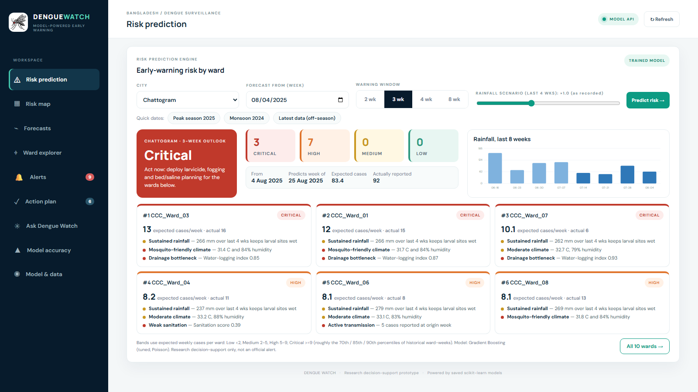
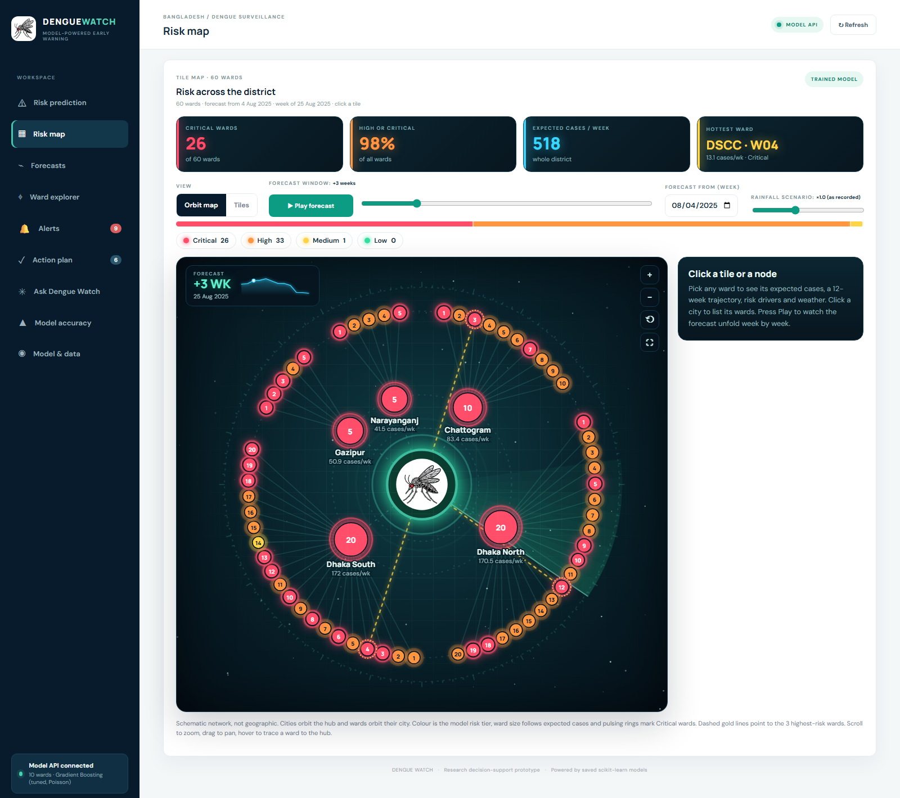
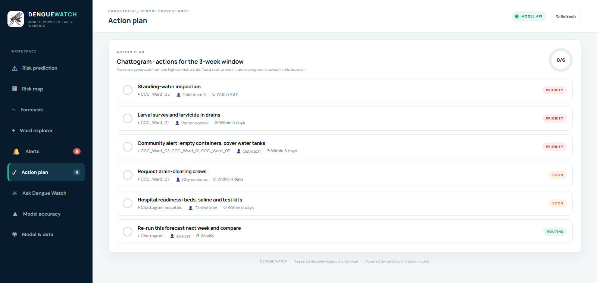

# Dengue Watch

Ward-level dengue forecasting and early-warning dashboard for Bangladesh.

[Live demo](https://dengue-watcher.onrender.com) · [Repository](https://github.com/Syed-Md-Abdud-Dayan/Solarix) · [Architecture notes](ARCHITECTURE.md)

Dengue Watch forecasts weekly dengue cases for 60 wards in five cities (Dhaka North, Dhaka South, Chattogram, Gazipur and Narayanganj), from a latest-week nowcast up to 12 weeks ahead. Forecasts are converted into Low, Medium, High and Critical risk bands, ward rankings, alerts and a task list for field teams.

This is a research prototype built on the supplied dataset. Its outputs are model estimates and are not official public-health alerts.

## Table of Contents

1. [Project Objective](#1-project-objective)
2. [Approach](#2-approach)
3. [Methodology](#3-methodology)
4. [Visualizations](#4-visualizations)
5. [Findings](#5-findings)
6. [Key Findings](#6-key-findings)
7. [Limitations](#7-limitations)
8. [Possible Improvements](#8-possible-improvements)
9. [Conclusion](#9-conclusion)
10. [How to Run](#10-how-to-run)
11. [Tools and Technologies](#11-tools-and-technologies)
12. [AI Exposure](#12-ai-exposure)

---

## 1. Project Objective

Dengue transmission in Bangladesh peaks during the monsoon, and city health teams must decide where to direct inspection and clean-up work before cases are reported. The project has four objectives:

1. Estimate expected weekly dengue cases for every ward, for horizons of 0 to 12 weeks.
2. Rank wards by risk so that limited resources can be directed to the highest-risk wards first. A warning window of 2 to 4 weeks is the default.
3. Explain the main drivers of each forecast (rainfall, temperature, humidity, ward conditions and season) in plain language.
4. Measure outbreak-warning quality with precision, recall and F1 on years that were not used for training.

## 2. Approach

The work followed five steps.

1. **Data profiling.** Ten years of weekly ward data were examined for seasonality, weather lags and differences between wards (Section 3.2).
2. **Leakage control.** Every weather and case input is shifted back by the forecast horizon, so a prediction uses only information that would have been available at forecast time.
3. **Model comparison.** One model is trained for each of 13 horizons. Five candidate models are compared with two baselines on a chronological train and test split.
4. **Evaluation.** Models are scored on 2023 to 2025 with count-aware metrics. Peak-season error is reported separately, because 58% of the rows are zero and an overall average hides poor peak-season performance.
5. **Delivery.** A Python API loads the saved models and serves a browser dashboard. No external service is called.

## 3. Methodology

### 3.1 Data

| Property | Value |
|---|---|
| File | `data/bangladesh_dengue_large_dataset.csv` |
| Size | 31,320 rows, 12 columns |
| Period | 2016-01-04 to 2025-12-29, 522 weekly records |
| Spatial unit | 60 wards (Dhaka North 20, Dhaka South 20, Chattogram 10, Gazipur 5, Narayanganj 5) |
| Total cases | 82,572 |
| Missing values | None; the panel is fully balanced |
| Target | `dengue_cases`, weekly count per ward (range 0 to 41, 58% zeros) |
| Weekly weather | Average, maximum and minimum temperature, rainfall, relative humidity |
| Fixed ward profile | Population density, water-logging risk index, sanitation score |

### 3.2 Exploratory Data Analysis

**Seasonality.** Mean weekly cases per ward are close to zero from November to March. They rise from May and peak in August (about 9.5) and September (about 8.5).

**Weather lags.** Rainfall correlates with cases at 0.53 in the same week, and the correlation peaks at 0.75 with a 3-week lag. Humidity peaks at about 0.66 with a 2-week lag. Temperature acts more slowly, with a correlation of about 0.63 at 8 weeks.

**Persistence.** The week-to-week correlation of cases is 0.75 and fades to roughly zero after 11 weeks.

**Ward differences.** Across the 60 wards, total cases correlate with the water-logging index (0.82), population density (0.57) and sanitation score (-0.40).

**Yearly variation.** City totals move together from year to year. 2016, 2019 and 2022 to 2023 were high years, and 2018, 2021 and 2024 were low years.

### 3.3 Model

Five candidates are trained for each horizon.

| Candidate | Description |
|---|---|
| Seasonal climatology | Baseline: mean cases for the ward and week of year |
| Persistence | Baseline: last known week's cases (horizons 1 to 12) |
| Poisson GLM | Linear count model with scaled and log-transformed inputs |
| Random Forest | 200 trees, minimum leaf size 5 |
| Gradient Boosting | Poisson loss, hyperparameters tuned by time-series cross-validation |
| Ensemble | Equal-weight average of Gradient Boosting and Random Forest |

Each ward-week has 37 to 45 input features: rainfall lags and 4, 8 and 12-week sums; temperature and humidity lags and rolling means; a rainfall-humidity interaction; ward case history (horizons 1 to 12 only, since horizon 0 is a weather-only nowcast); density, sanitation, water-logging and city indicators; and sine and cosine terms for the week of year.

The target is a count with many zeros, so Poisson deviance is used as the training loss for boosting and as the criterion for choosing the best model.

### 3.4 Model Training

The data are split by time and never shuffled. Models are trained on years before 2023 (about 21,000 rows) and tested on 2023 to 2025 (9,420 rows).

Gradient Boosting settings are chosen from 10 random configurations by mean Poisson deviance over three expanding-window folds, validating on 2020, 2021 and 2022 in turn. The test years play no part in tuning.

For each horizon the best machine-learning model by test deviance was Gradient Boosting at 6 horizons, the ensemble at 5 and the Poisson GLM at 2. For deployment, one Gradient Boosting model per horizon is refit on all years (2016 to 2025) and saved as `artifacts/models/model_h0.joblib` to `model_h12.joblib`. Permutation importance by signal group and partial dependence curves are written to `artifacts/results.json`.

### 3.5 Model Evaluation

All figures below come from models trained on earlier years and scored on the 2023 to 2025 test period. MAE is measured in cases per ward per week.

**Forecast accuracy**

| Horizon | Best model | MAE | R² | Peak-season MAE | Outbreak AUC | Persistence MAE |
|---|---|---:|---:|---:|---:|---:|
| 0 (weather-only nowcast) | Gradient Boosting | 0.87 | 0.85 | 1.84 | 0.98 | n/a |
| 1 week | Poisson GLM | 1.03 | 0.80 | 2.16 | 0.97 | 1.56 |
| 3 weeks | Gradient Boosting | 1.10 | 0.77 | 2.35 | 0.96 | 2.14 |
| 8 weeks | Gradient Boosting | 1.34 | 0.64 | 2.89 | 0.93 | 3.25 |
| 12 weeks | Ensemble | 1.35 | 0.64 | 2.92 | 0.93 | 4.19 |
| Seasonal climatology | n/a | 1.36 | 0.63 | 2.94 | 0.93 | n/a |

**Outbreak warnings.** An outbreak is defined as 10 or more cases in one ward-week, which occurs 869 times in the 9,420 test rows. An alarm is raised when the predicted value reaches a threshold. The table shows results at a threshold of 10 cases. The dashboard allows other thresholds from 3 to 12.

| Horizon | Precision | Recall | F1 |
|---|---:|---:|---:|
| 0 (nowcast) | 81.9% | 58.8% | 68.5% |
| 3 weeks | 67.9% | 55.7% | 61.2% |
| 8 weeks | 53.6% | 46.4% | 49.7% |

## 4. Visualizations

Screenshots of the deployed dashboard are stored in `docs/screenshots/`. Unless stated otherwise, they show Chattogram with a 3-week warning window from 4 August 2025, a peak-season week chosen so that the pages have meaningful values.

### 4.1 Risk prediction

The home page takes a city, a forecast week, a warning window of 2, 3, 4 or 8 weeks and an optional rainfall scenario. It returns an overall city risk level, counts of wards in each band, the expected and actually reported cases for the target week, the last eight weeks of rainfall, and a card for each high-risk ward listing the factors behind its rating.



### 4.2 Risk map

A schematic network of all 60 wards, available as an orbit view (shown) or a tile view. Cities orbit a central hub and wards orbit their city. Colour shows the risk band, size follows expected cases, and pulsing rings mark Critical wards. The summary cards report the number of Critical wards, the share of wards at High or Critical, expected weekly cases across the districts and the highest-risk ward. A play control steps through the forecast week by week. The layout is not geographic, because the dataset has no coordinates.



### 4.3 Forecasts and history

Predicted cases for horizons 0 to 12 weeks, the signal groups that contribute most to the model, and the recent weekly history of reported cases. This page always uses the last week in the dataset (29 December 2025), which is off-season, so predicted and reported cases are close to zero here.


### 4.4 Ward explorer

A ranked table of wards with predicted cases, last reported cases, relative priority, rainfall and the water-logging index, with search by ward ID and CSV export. As on the forecasts page, the data shown is the off-season final week, so estimates are near zero.


### 4.5 Alerts

Alerts generated from the current prediction, ordered by severity, each with its main driver. Alerts can be marked as read.


### 4.6 Action plan

A task list generated from the highest-risk wards, with an owner, a time frame and a priority for each task. Completed tasks are saved in the browser.



### 4.7 Model accuracy

Precision, recall and F1 for outbreak warnings on the held-out test period, with an adjustable alarm threshold, a confusion matrix and a table for every horizon.


### 4.8 Ask Dengue Watch

A rule-based helper that answers questions from the figures currently on screen. It offers suggested questions such as which ward needs attention first and how reliable the forecast is.


### 4.9 Model and data

The forecast model, the training and test split, evaluation metrics for the selected horizon, the dataset period and the saved model file, together with the main limitation notice.


## 5. Findings

**Weather explains most of the short-range signal.** The nowcast uses no case reports and still reaches R² of 0.85 and MAE of 0.87. Weather, season and ward profile carry most of the predictive information.

**Rainfall leads cases by about three weeks.** Rainfall is the largest contributor at 1 to 3 weeks ahead. Season and temperature become more important at longer horizons.

**The models improve on both baselines at short range.** At 3 weeks the best model has an MAE of 1.10, compared with 1.36 for seasonal climatology and 2.14 for persistence. Persistence declines rapidly and has a negative R² by 8 weeks.

**Peak-season error is roughly double the overall error.** MAE for June to October is about twice the all-year figure at every horizon, which is why it is reported separately.

**Ward conditions are consistent predictors.** Wards with a higher water-logging index, higher density and lower sanitation score have more cases throughout the period.

**Long-range forecasts add little over the seasonal average.** At 12 weeks the best model reaches an MAE of 1.35, against 1.36 for seasonal climatology. Beyond about 4 weeks the forecast mainly reproduces the typical seasonal pattern.

## 6. Key Findings

- Forecasts are most useful 0 to 4 weeks ahead, which matches the dashboard's default warning window.
- At 3 weeks ahead, about 68% of outbreak alarms were correct and about 56% of outbreaks were detected, at a threshold of 10 cases.
- Rainfall is the earliest useful signal, appearing about three weeks before cases.
- Ward rankings depend mainly on water-logging, density and sanitation, so they are stable and easy to explain.
- Everything runs locally, with cached predictions and no external API calls.

## 7. Limitations

- **Data origin.** The dataset may be partly or wholly simulated: it has no missing values, its ward profiles are constant for ten years and its seasonality is very regular. Results describe this dataset and have not been validated against surveillance records.
- **No geography.** Without coordinates or boundaries, the risk map is a schematic layout and spread between neighbouring wards cannot be modelled.
- **Association only.** Feature importance and the rainfall scenario slider show relationships in the data. They do not establish cause.
- **Observed weather.** The models use recorded weather. Reliable forecasts beyond a few weeks would require external weather forecasts.
- **Static ward profiles.** Sanitation, water-logging and density do not change over time, so their changing effect cannot be studied.
- **Missing context.** There is no ward population, so incidence per 100,000 people cannot be computed. Mosquito, serotype and intervention data are also absent.
- **Back-testing.** Deployed models are refit on all years. Back-testing a date in 2023 to 2025 therefore uses a model that has seen that week and will look better than the test results in Section 3.5.
- **Small cities.** Gazipur and Narayanganj have five wards each, so conclusions for them are weaker.
- **Data currency.** The data end on 2025-12-29. Forecasts are measured from that date and do not represent current conditions.
- **Risk labels.** Priority labels are ranks within a city. The Low to Critical bands are fixed cut-offs on expected cases (Low below 2, Medium 2 to 5, High 5 to 9, Critical 9 or more). Neither is a calibrated probability.

## 8. Possible Improvements

- Connect current case reports and weather forecasts so the system can be used operationally.
- Add prediction intervals using quantile or count-distribution models.
- Deploy the best model for each horizon. Gradient Boosting is currently used everywhere, although the Poisson GLM or the ensemble scored slightly better at some horizons.
- Add real ward boundaries and populations to support a geographic map and incidence rates.
- Model spread between neighbouring wards once adjacency is known.
- Add per-ward explanations (for example SHAP) and calibrated outbreak probabilities.
- Add automated tests, monitoring and scheduled retraining as new weeks arrive.
- Add SMS or email notifications and a Bangla interface for field teams.

## 9. Conclusion

In this dataset, ward-level dengue risk can be forecast usefully a few weeks ahead from weather, season and ward conditions alone. Rainfall provides an early signal of about three weeks, and the models clearly outperform the baselines at 0 to 4 weeks. At longer horizons the forecasts converge to the seasonal average, and the dashboard states this. The result is a locally run decision-support prototype that ranks wards, shows the drivers of each forecast and reports accuracy measured on held-out years. Operational use would require validated, current surveillance and weather data.

## 10. How to Run

Requirements: Python 3.10 or newer. The saved models were created with scikit-learn 1.9.1, so the pinned version should be installed.

```bash
git clone https://github.com/Syed-Md-Abdud-Dayan/Solarix.git
cd Solarix

python -m venv .venv
# Windows PowerShell:  .venv\Scripts\Activate.ps1
# Windows Git Bash:    source .venv/Scripts/activate
# macOS / Linux:       source .venv/bin/activate

python -m pip install --upgrade pip
pip install -r requirements.txt
pip install -e .

python app.py
```

Open http://127.0.0.1:5000 in a browser and keep the terminal running. No Node.js, Flask or frontend build step is required.

To check the API, run `python verify_api.py`. To retrain the models, run `python scripts/train_dengue.py` and restart `app.py`. Retraining rewrites `artifacts/models/`, `artifacts/predictions/` and `artifacts/results.json`.

### API endpoints

| Endpoint | Description |
|---|---|
| `GET /api/health` | Status, number of models, cities, ward count and latest date |
| `GET /api/dashboard?city=Chattogram&horizon=3` | City totals, forecast series, history, metrics and ward predictions |
| `GET /api/risk?city=Dhaka%20North&as_of=2025-08-04&horizon=3&rain_mult=1.0` | Ward risk bands, drivers, 8-week rainfall and back-test actuals |
| `GET /api/map` | Ward tile data for the risk map |
| `GET /api/ward/CCC_Ward_01?horizon=3` | Prediction for a single ward |

### Project structure

```
app.py                     API and static file server
data/                      Source dataset (CSV)
src/dengue_watch/          features.py, evaluation.py, pipeline.py, eda.py
scripts/train_dengue.py    Training entry point
artifacts/                 Saved models, test predictions, results.json
web/                       Dashboard (HTML, JavaScript, CSS, images)
docs/screenshots/          Images used in this README
ARCHITECTURE.md            Data flow, validation split and model selection
plan.md                    Scope and feasibility notes
```

## 11. Tools and Technologies

| Area | Tools |
|---|---|
| Languages | Python 3.10+, JavaScript, HTML, CSS |
| Data processing | pandas, NumPy |
| Machine learning | scikit-learn 1.9.1 (HistGradientBoostingRegressor, RandomForestRegressor, PoissonRegressor), joblib |
| Interpretation | Permutation importance, partial dependence |
| Backend | Python standard-library HTTP server |
| Frontend | Static dashboard with SVG charts; no framework or build step |
| Packaging | setuptools (`pyproject.toml`) |
| Hosting | Render |
| Version control | Git, GitHub |

## 12. AI Exposure

**AI in the product.** The forecasting models are classical machine-learning models (gradient boosting, random forest and Poisson regression) trained on the supplied dataset. They are not large language models. The Ask Dengue Watch helper is rule-based and answers from the figures on screen. The application calls no external AI service, and no user data leaves the server.

**AI in development.** Claude (Anthropic) was used as an assistant for [list the tasks, for example: code review, dividing the codebase between team members, suggesting features, drafting descriptions and writing this README]. Model results quoted in this document come from the project's own training pipeline and saved artifacts, and dataset statistics were computed directly from the CSV. The team reviewed all generated material and is responsible for the final project.