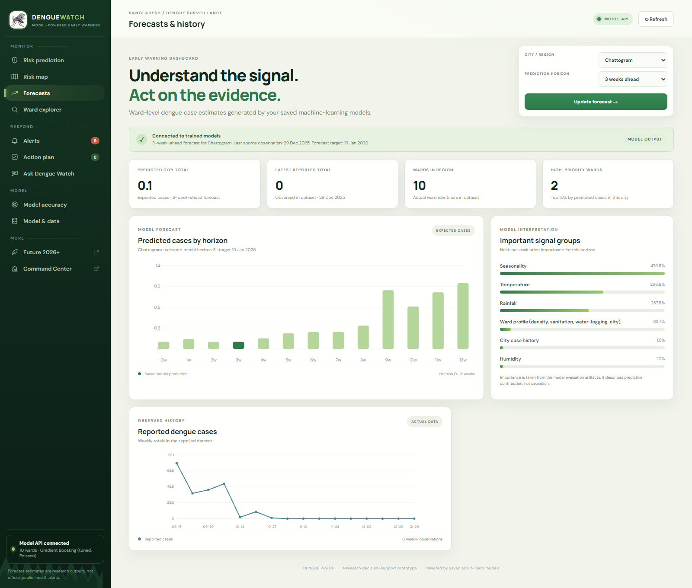
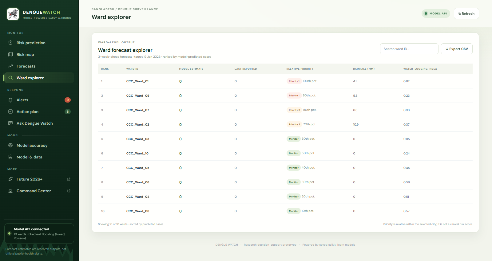

# Dengue Watch

**A ward-level dengue forecasting and early-warning dashboard for Bangladesh.**

Dengue Watch analyzes weekly case and weather data across 60 wards in five cities. It produces forecasts up to 12 weeks ahead, classifies ward-level risk, and presents alerts, visual analytics, and an English–Bangla information assistant.

> **Research prototype:** This project is intended for experimentation and decision-support research. It is not an official public-health warning system, and its results have not been validated against independent surveillance records.

[Live Demo](https://dengue-watcher.onrender.com) · [Architecture](ARCHITECTURE.md) · [Project Plan](plan.md)

---
## Team Solarix
 
| Name | Student ID |
|---|---|
| Md. Abrar Hossain | 232006512 |
| Syed Mohammad Abdud Dayan | 232001312 |
| Mohtada Ayesha Aalim Chowdhury | 232007512 |
## Overview

The dashboard is designed to help users explore where dengue risk may increase and how that risk changes over time.

- **Ward-level forecasting:** Estimates weekly dengue cases from the current week to 12 weeks ahead.
- **Risk classification:** Groups predicted cases into Low, Medium, High, and Critical risk levels.
- **Ward exploration:** Compare wards and inspect their forecast trends.
- **Alerts and action planning:** Surface higher-risk wards and provide suggested follow-up actions.
- **Long-range outlook:** Explore a seasonal forecast for 2026–2027.
- **Bilingual assistant:** Ask Dengue Watch questions in English or Bangla.

## Dashboard

<p align="center">
  
</p>

<p align="center">
  
  
</p>

<p align="center">
  
  
</p>

<p align="center">
  
  
</p>

<p align="center">
  
</p>

*The risk-map view is a schematic network, not a geographic map. The dataset does not contain ward coordinates or boundary geometries.*

## Dataset

The project uses `data/bangladesh_dengue_large_dataset.csv`, containing:

| Attribute | Description |
|---|---|
| Coverage | 60 wards across five cities |
| Cities | Dhaka North, Dhaka South, Chattogram, Gazipur, and Narayanganj |
| Period | 2016–2025 |
| Records | 31,320 weekly ward records |
| Target | Weekly dengue case count |
| Predictors | Weather variables and ward-level profile features |

The dataset contains a high proportion of zero-case records. Its regular patterns and fixed ward profiles suggest that it may be partly or wholly simulated. Therefore, the reported performance should be interpreted as performance on this dataset—not as evidence of real-world outbreak prediction accuracy.

## Methodology

The forecasting pipeline builds horizon-specific features from weather history, seasonal signals, ward profiles, and (for horizons greater than zero) historical case counts.

Candidate models include:

- Poisson Generalized Linear Model
- Random Forest
- Gradient Boosting with Poisson loss
- A Gradient Boosting–Random Forest ensemble
- Seasonal-average and persistence baselines

Models are evaluated using a chronological split: training on data before 2023 and testing on 2023–2025. Hyperparameter tuning uses earlier time-based folds. The saved serving models are subsequently refit on the full dataset.

All time-varying inputs are shifted according to the forecast horizon to avoid using future information when generating a prediction.

## Evaluation

Selected held-out test results are shown below. MAE is measured in cases per ward per week.

| Forecast horizon | MAE | R² | Outbreak AUC |
|---|---:|---:|---:|
| Weather-only nowcast | 0.87 | 0.85 | 0.98 |
| 3 weeks ahead | 1.10 | 0.77 | 0.96 |
| 12 weeks ahead | 1.35 | 0.64 | 0.93 |

At three weeks ahead, using 10 or more cases in a ward-week as the outbreak threshold, the reported alarm precision is 67.9%, recall is 55.7%, and F1 is 61.2%.

**How to interpret these results:** Short-range forecasts outperform the seasonal-average baseline in this dataset. At 12 weeks, performance is approximately equal to the seasonal average. Errors are higher during the June–October peak season. The system is more useful for exploring near-term patterns than for predicting the exact timing or magnitude of a future outbreak.

## Long-range outlook

The project also generates a 2026–2027 seasonal outlook. Beyond the 12-week model horizon, historical weather patterns are used to estimate expected seasonal values and an 80% range.

This is a scenario-based seasonal view, not a year-specific weather forecast. Since the available data does not distinguish future weather conditions for 2026 from 2027, their projections are similar by design.

## Technology Stack

| Area | Tools |
|---|---|
| Language | Python |
| Data processing | pandas, NumPy |
| Machine learning | scikit-learn |
| Model persistence | joblib |
| Backend | Python standard-library HTTP server |
| Frontend | HTML, CSS, JavaScript, SVG |
| Testing | pytest |
| Deployment | Render |

The application does not require Node.js or an external AI API. The Ask Dengue Watch assistant uses a project knowledge base and model outputs; it is not a generative-AI diagnostic system.

## Getting Started

### Requirements

- Python 3.10+
- pip

The saved models require the pinned scikit-learn version in `requirements.txt`.

### Installation

```bash
git clone https://github.com/Syed-Md-Abdud-Dayan/Solarix.git
cd Solarix

python -m venv .venv

# Windows PowerShell
.venv\Scripts\Activate.ps1

# macOS / Linux
source .venv/bin/activate

pip install -r requirements.txt
pip install -e .
```

### Run the application

```bash
python app.py
```

Open **http://127.0.0.1:5000** in your browser. The long-range forecast page is available at `/future.html`.

## Useful Commands

| Task | Command |
|---|---|
| Run tests | `pip install -r requirements-dev.txt && python -m pytest tests -q` |
| Verify API | `python verify_api.py` |
| Retrain forecasting models | `python scripts/train_dengue.py` |
| Export future forecast | `python scripts/forecast_future.py --end 2027-12-31` |
| Run long-range backtest | `python scripts/backtest_future.py` |

## API

The application exposes the following endpoints:

| Method | Endpoint | Purpose |
|---|---|---|
| GET | `/api/health` | Service health check |
| GET | `/api/dashboard` | Dashboard summary data |
| GET | `/api/risk` | Ward-level risk information |
| GET | `/api/map` | Schematic ward network data |
| GET | `/api/ward/<id>` | Details for a ward |
| GET | `/api/future` | Long-range forecast |
| GET | `/api/chat/suggestions` | Assistant prompt suggestions |
| POST | `/api/chat` | Ask the bilingual assistant |

## Repository Structure

```text
Solarix/
├── app.py                       # HTTP server and API routes
├── data/                        # Source dengue dataset
├── artifacts/                   # Trained models, metrics and forecasts
├── src/dengue_watch/             # Features, training, evaluation and assistant
├── scripts/                     # Training and forecast scripts
├── web/                         # Dashboard frontend
├── docs/screenshots/             # README dashboard screenshots
├── tests/                        # Automated tests
├── ARCHITECTURE.md               # System and model architecture
├── plan.md                       # Project plan
├── requirements.txt
└── pyproject.toml
```

## Limitations

- The dataset may be simulated and has not been independently validated against official surveillance data.
- Ward coordinates, geographic boundaries, and population denominators are unavailable; the map is therefore schematic and incidence rates cannot be calculated.
- Risk bands are fixed thresholds on predicted case counts, not calibrated probabilities.
- Feature importance and what-if controls indicate associations, not causal effects.
- The deployed models are refit on all available years. Historical in-app predictions should not be confused with the held-out test results.
- Forecast uncertainty and accuracy deteriorate at longer horizons.

## Future Work

- Validate and retrain with verified, regularly updated surveillance data.
- Integrate operational weather forecasts and ward-level geographic boundaries.
- Add population-normalized incidence estimates.
- Add calibrated outbreak probabilities and ward-level explanations.
- Introduce scheduled retraining, model monitoring, and configurable notifications.

## Responsible Use

Dengue Watch provides exploratory forecasts and general educational information. It does not diagnose dengue, replace medical advice, or issue official public-health alerts. Any public deployment should include validation by epidemiologists and review of health guidance and hotline information by qualified professionals.

---

## Acknowledgement

This project was developed with AI-assisted support for planning, code review, and documentation. The team is responsible for reviewing the implementation and reported results.

